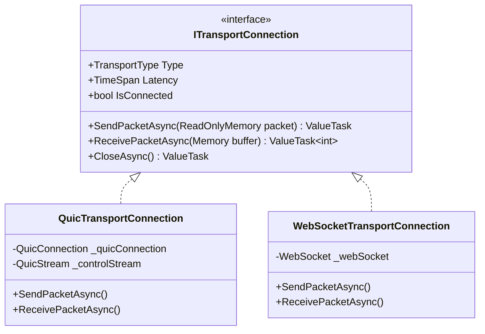

# LANVC — Архитектурный документ и спецификация системы (Stage 1)

## 1. Введение и назначение системы

**LANVC (LAN Virtual Controller)** — программный комплекс для создания защищённых виртуальных локальных сетей (VLAN / Virtual LAN) поверх глобальной сети Интернет по топологии **Hub-and-Spoke** (централизованная звезда).
Система предназначена для объединения компьютеров под управлением Windows 10/11 в единое виртуальное сетевое пространство, обеспечивая бесшовное функционирование сетевых компьютерных игр (LAN multiplayer), требующих TCP/UDP взаимодействия, а также широковещательного (Broadcast) и многоадресного (Multicast) обнаружения игровых серверов (Minecraft LAN, Source Engine, Unreal Engine, DirectPlay, Warcraft III, Terraria и др.).

---

## 2. Сравнительный анализ технологий реализации

Перед выбором технологического стека был проведён детальный сравнительный анализ 4 платформ:

| Критерий | .NET 10 / C# 13 (Выбран) | Rust (Cargo) | C++20 / Win32 | Go (Golang) |
| :--- | :--- | :--- | :--- | :--- |
| **Производительность сети** | Экстремальная (`Span<T>`, `Memory<T>`, `SocketAsyncEventArgs`, ArrayPool, аппаратный SIMD) | Максимальная (Zero-cost abstractions, direct memory control) | Максимальная, ручное управление памятью | Высокая, но GC паузы могут влиять на джиттер сетевых пакетов |
| **Поддержка QUIC & Datagrams** | Встроенная через `System.Net.Quic` (MsQuic) на уровне BCL с поддержкой RFC 9000 & 9221 | Крейты `quinn` / `s2n-quic` (требуют сложной асинхронной сборки на Windows) | Требует ручной линковки `msquic` C API | Внешние библиотеки `quic-go` (сложности с Win-сервисами) |
| **Разработка GUI (Windows 10/11)** | Нативный WPF (XAML, Hardware Acceleration, Fluent/Dark Design, Pixel-Perfect репликация макета) | `egui` / `slint` / `iced` (ограниченная поддержка accessibility, шрифтов Windows, сложность кастомизации) | WinUI 3 / Qt (тяжеловесный runtime, громоздкий tooling) | Fyne / Wails (требует WebView2 или OpenGL, высокий оверхед по памяти) |
| **Интеграция с Windows** | Нативная поддержка Windows Services (`BackgroundService`), Win32 P/Invoke, Credential Manager, Wintun | P/Invoke через `windows-rs` / `winapi` | Нативная | Cgo / `golang.org/x/sys/windows` |
| **Единая кодовая база** | 100% общий стек для Client, Server, CLI Admin, Core, Adapter | Возможен, но усложнён GUI | Разделение GUI и ядра | Разделение GUI и ядра |
| **Сборка и распространение** | Single-file Executable, ReadyToRun, Trimming, без сторонних зависимостей | Единый бинарник | Требует VC++ Redistributable | Единый бинарник |

**Итог выбора:**
Выбран **.NET 10 (C# 13)**. Он предоставляет полноценную нативную поддержку Microsoft MsQuic (QUIC с Datagrams), Kestrel / WebSocket с TLS 1.3, высокопроизводительное ядро с нулевым копированием памяти (`ArrayPool<byte>`, `ReadOnlySpan<byte>`), аппаратный WPF для графического интерфейса в темной теме, и нативные API Windows Services для серверной части.

---

## 3. Анализ и выбор виртуального сетевого адаптера

В Windows доступно несколько решений для создания виртуальных сетевых интерфейсов:

| Параметр | Wintun (Выбран) | TAP-Windows v6 (OpenVPN) | WinDivert (Packet Divert) |
| :--- | :--- | :--- | :--- |
| **Уровень OSI** | Уровень 3 (Network / IP packets) | Уровень 2 (Data Link / Ethernet frames) | Уровень 3-4 (Фильтрация и перехват) |
| **Драйвер и подпись** | WHQL-подписан Microsoft, безопасная установка на Win 10/11, HVCI совместим | Требует отдельный TAP-инсталлятор, возможны конфликты с новыми версиями Windows | Требует `windivert.sys`, часто детектируется античитами и антивирусами как руткит |
| **Производительность** | Экстремальная: lock-free кольцевые буферы (Ring Buffer) до 64 МБ, миллионы pps | Средняя: классический NDIS адаптер, оверхед на Ethernet заголовки | Задержка на перехват в ядре |
| **Установка** | Динамическая: `wintun.dll` сама регистрирует драйвер из встроенных ресурсов | Требует inf / setupapi / tapinstaller | Требует инсталляции службы |
| **Broadcast / Multicast** | Требует правильной конфигурации маршрутов и вспомогательного ретранслятора | Нативно (Layer 2 Ethernet Broadcast) | Требует ручной инъекции пакетов |

**Архитектурное решение LANVC:**
1. В качестве основного драйвера используется **Wintun**: он WHQL-сертифицирован, не требует отключения Secure Boot / Memory Integrity, создаёт виртуальный адаптер со скоростью работы в гигабитах и задержкой менее 0.1 мс.
2. Для преодоления ограничения Layer 3 (TUN не имеет заголовков Ethernet) LANVC реализует:
   - **Маршрутизацию широковещательных пакетов (Broadcast)**: пакеты с IP `255.255.255.255` и `10.77.0.255` направляются в адаптер Wintun и ретранслируются сервером всем клиентам сети.
   - **Маршрутизацию многоадресных пакетов (Multicast)**: диапазон `224.0.0.0/4` направляется в туннель.
   - **Встроенный LAN Discovery Relay (мост обнаружения игр)**: вспомогательный модуль клиента перехватывает игровые анонсы (Minecraft LAN 4445, Source Engine 27015/27016, DirectPlay 2300-2400/47624, Steam Discovery 27036) и обеспечивает их гарантированную доставку игровым клиентам.

---

## 4. Спецификация сетевых протоколов и формата пакетов

### 4.1. Формат кадра LANVC Protocol (LANVC Binary Frame Protocol)

Все сообщения передаются через защищённый туннель в бинарном формате с контролем целостности и минимальным оверхедом (всего 5 байт заголовка для пакетов данных):

```
+-------------------+--------------------+------------------------+------------------------------------+
| Magic (2 bytes)   | Type (1 byte)      | Payload Length (2 b)   | Payload (Variable length, 0..MTU)  |
| 0x4C 0x56 ("LV")  | MessageType Enum   | Big-Endian uint16      | Encrypted / Authenticated data     |
+-------------------+--------------------+------------------------+------------------------------------+
```

### 4.2. Типы сообщений (`MessageType`):

1. `0x01` — `HandshakeRequest`:
   - Protocol Version (uint16)
   - Client Peer Name (UTF-8, до 32 символов)
   - Salted Password Auth Token / Nonce (32 байта)
   - Preferred Virtual IP (опционально, 4 байта)
2. `0x02` — `HandshakeResponse`:
   - Status Code (uint8): `0 = Success`, `1 = Bad Password`, `2 = Server Full (max 10)`, `3 = Protocol Mismatch`, `4 = Banned/RateLimited`
   - Assigned Virtual IP (4 байта, e.g. `10.77.0.2`)
   - Subnet Mask (4 байта, e.g. `255.255.255.0`)
   - Server Virtual IP (4 байта, e.g. `10.77.0.1`)
   - Keepalive Interval (uint16 секунд)
   - Assigned Peer ID (uint16)
3. `0x03` — `DataPacket` (IP Packet Encapsulation):
   - Raw IPv4/IPv6 packet payload (от 20 до 1500 байт)
   - Извлекается непосредственно из адаптера Wintun и инкапсулируется в кадр.
4. `0x04` — `PeerListUpdate`:
   - Count (uint8)
   - Список участников: `[PeerId: uint16, VirtualIP: uint32, Hostname: string, LatencyMs: uint16, OnlineDurationSec: uint32]`
5. `0x05` — `Ping`:
   - Timestamp (int64 ticks)
6. `0x06` — `Pong`:
   - Echoed Timestamp (int64 ticks)
7. `0x07` — `DisconnectNotice`:
   - Reason Code (uint8), Description (UTF-8)
8. `0x08` — `GameDiscoveryBroadcast`:
   - Порт назначения, длина, полезная нагрузка анонса игры (например, Minecraft `[MOTD]...[/MOTD]`).

---

## 5. Модульный транспортный уровень (Transport Layer)

Транспортный уровень спроектирован полностью абстрагированным от сетевого ядра:



### 5.1. Основной транспорт: QUIC (RFC 9000, RFC 9221)
- Работает по протоколу UDP через порт по умолчанию `443` (или настраиваемый, например `4433`).
- Шифрование: **TLS 1.3** с алгоритмами `TLS_AES_128_GCM_SHA256` и `TLS_CHACHA20_POLY1305_SHA256`.
- **QUIC Datagrams**: передача игровых пакетов без ожидания повторной отправки (Unreliable Datagrams), что устраняет Head-of-Line Blocking и обеспечивает минимальный пинг в онлайн-играх.
- Bidirectional Control Stream: надёжная доставка управляющих сообщений (авторизация, списки пиров, смена конфигурации).

### 5.2. Резервный транспорт: WebSocket over TLS 1.3 (WSS)
- Работает по стандартному порту **443 HTTPS**.
- Выполняет корректный RFC 6455 HTTP/1.1 Upgrade:
  ```http
  GET /lanvc HTTP/1.1
  Host: 203.0.113.42:443
  Upgrade: websocket
  Connection: Upgrade
  Sec-WebSocket-Key: ...
  Sec-WebSocket-Version: 13
  ```
- Обеспечивает прохождение через жесткие корпоративные брандмауэры и провайдерские DPI, пропускающие только порт 443 TCP/HTTPS.
- Ограничение TCP-over-TCP минимизируется за счёт исключения искусственных повторных очередей пакетов в LANVC и установки низких таймаутов буферов (`TCP_NODELAY`).

### 5.3. Автоматический Failover & Reconnect
1. Клиент пытается установить QUIC соединение с таймаутом 3.0 секунды.
2. При блокировке UDP или недоступности QUIC происходит мгновенное автоматическое переключение на WebSocket по порту 443.
3. При потере соединения включается экспоненциальный backoff: попытки 1с, 2с, 4с, 8с (до 15с) с индикацией статуса в GUI.

---

## 6. Маршрутизация и Hub-and-Spoke диспетчеризация

### 6.1. Алгоритм маршрутизации на сервере:
1. Сервер поддерживает таблицу соответствия `VirtualIP -> ClientSession`.
2. При поступлении `DataPacket` сервер инспектирует заголовок IPv4:
   - Проверяет валидность версии IP (IPv4 = 4).
   - Извлекает `Destination IP` (байты 16..19 заголовка IPv4).
3. **Разрешение адреса:**
   - **Универсальный широковещательный адрес (`255.255.255.255`) или широковещательный адрес подсети (`10.77.0.255`):**
     Пакет дублируется и отправляется всем активным клиентам сети, кроме отправителя.
   - **Многоадресный диапазон (`224.0.0.0` - `239.255.255.255`):**
     Пакет направляется всем активным клиентам сети, кроме отправителя.
   - **Одноадресный адрес (Unicast):**
     Если `Destination IP == Server Virtual IP` (`10.77.0.1`): обрабатывается локальным IP-стеком сервера (например, ping к серверу).
     Если `Destination IP == 10.77.0.X`: ищется сессия клиента `X`. Если клиент найден — пакет немедленно пересылается ему.
     Если клиент не найден или IP посторонний — пакет отбрасывается (защита от утечки в чужие сети).

### 6.2. Проверка и предотвращение конфликтов подсетей:
Перед назначением виртуальной подсети клиент опрашивает сетевые интерфейсы через `GetAdaptersAddresses` / `NetworkInterface.GetAllNetworkInterfaces()`. Если подсеть пользователя уже использует `10.77.0.0/24` (крайне редкий случай), клиент запрашивает у сервера альтернативный диапазон (`10.78.0.0/24` или `172.26.0.0/24`).

---

## 7. Модель угроз (STRIDE Analysis)

| Категория STRIDE | Потенциальная угроза | Мера защиты в LANVC |
| :--- | :--- | :--- |
| **Spoofing (Подмена)** | Подделка IP сервера (MITM) или подделка клиента в виртуальной сети | Аутентификация сервера через TLS 1.3 с привязкой отпечатка сертификата (Certificate Pinning / SHA-256 Fingerprint). Сервер строго валидирует `Source IP` каждого пакета (клиент может отправлять пакеты только со своего назначенного Virtual IP). |
| **Tampering (Искажение данных)** | Модификация сетевых пакетов на промежуточных узлах сети Интернет | Шифрование всего туннельного трафика по стандарту TLS 1.3 (AEAD шифры AES-GCM / ChaCha20-Poly1305) с контролем целостности каждого кадра. |
| **Repudiation (Отказ от авторства)** | Участник отрицает передачу пакетов | Серверная криптографическая сессия с уникальным сессионным ключом и журналированием идентификаторов пиров. |
| **Information Disclosure (Утечка)** | Перехват трафика игр и паролей провайдером или злоумышленником | Пароли передаются только внутри защищённого TLS-канала, на сервере хранятся исключительно в виде хешей **Argon2id**. В логах пароли и ключи маскируются. |
| **Denial of Service (DoS)** | Брутфорс пароля сети, флуд пакетами, исчерпание пула IP | Token Bucket Rate Limiting (максимум 5 попыток ввода пароля в минуту с одного публичного IP), строгий лимит подключений (10 пользователей), ограничение размера буфера Wintun и троттлинг широковещательных пакетов. |
| **Elevation of Privilege** | Эксплуатация уязвимостей драйвера сетевого адаптера | Использование WHQL-сертифицированного официального драйвера Wintun, запуск серверной службы с изолированными правами Network Service / Local System. |

---

## 8. Потенциальные ограничения архитектуры и способы их компенсации

1. **DPI и блокировка UDP у некоторых мобильных провайдеров:**
   - *Компенсация:* Автоматическое переключение на WebSocket поверх стандартного порта 443 HTTPS. Трафик выглядит как стандартное HTTPS веб-соединение.
2. **TCP-over-TCP при использовании WebSocket резервного транспорта:**
   - *Компенсация:* Использование алгоритма Nagle off (`NoDelay = true`), мелких буферов передачи без локальной очереди повторов UDP. При восстановлении UDP клиент автоматически предлагает перейти обратно на быстрый QUIC.
3. **Отсутствие Layer 2 Ethernet фреймов в Wintun:**
   - *Компенсация:* Реализация специального модуля `LanDiscoveryRelay`, который эмулирует и пробрасывает многоадресные анонсы на сокетах приложений.
4. **Ограничение MTU:**
   - При инкапсуляции IP пакетов в QUIC/WebSocket расходуется от 25 до 60 байт на внешние заголовки.
   - *Компенсация:* Виртуальный адаптер Wintun конфигурируется с **MTU = 1420 байт** (вместо стандартного 1500). Это исключает фрагментацию пакетов на физическом сетевом оборудовании.
